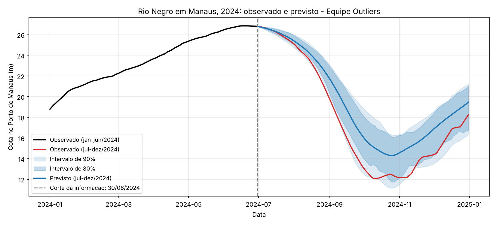
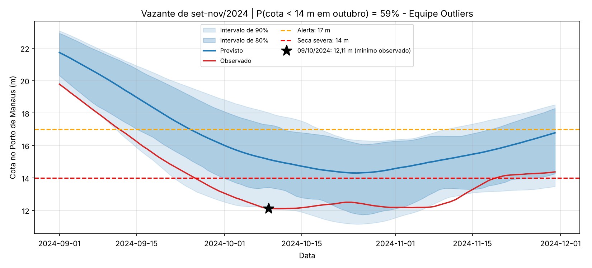

# rio-negro-2024-prev

[](https://github.com/assisgb/rio-negro-2024-prev/actions/workflows/ci.yml)

Previsão diária da cota do **Rio Negro em Manaus** (Porto de Manaus) de **01/07 a 31/12/2024**, usando apenas informação publicada até **30/06/2024**.
Entrega da **Equipe Outliers** no Hackathon Ocean (Samsung Ocean / UEA):
Hugo Carvalho de Moraes, Gabriel Assis da Silva e Juan Victor Sequeira.



## Resultado

| | |
|---|---|
| Mínimo previsto | **14,30 m em 25/10/2024** (observado: 12,11 m em 09/10/2024) |
| Probabilidade de cota < 14 m em outubro | **59%** (17 de 29 trajetórias do backtest) |
| Probabilidade de cota < 17 m em outubro | 97% |
| Nota final (regras do hackathon, menor é melhor) | **2,27 m**; 2,07 m com o bônus de alerta |
| Baseline (média dos últimos 15 anos) | 3,13 m |

O modelo previu uma seca severa, mas ficou mais ameno que o observado (o mínimo real foi mais fundo e ocorreu antes).
Backtest 1995–2023 com treino só em anos anteriores a cada ano: nota média 1,43 contra 1,65 do baseline
(2005–2023: 1,15 contra 1,52; anos de seca 2005/2010/2015/2023: 1,38 contra 2,77).
O resumo completo está em [`docs/Resumo_modelo_Equipe_Outliers.pdf`](docs/Resumo_modelo_Equipe_Outliers.pdf).



## Como rodar

Requer Python 3.10 ou mais novo.

```bash
git clone https://github.com/assisgb/rio-negro-2024-prev.git
cd rio-negro-2024-prev
python -m venv .venv && source .venv/bin/activate      # no Windows: .venv\Scripts\activate
pip install -r requirements.txt
python previsao_rio_negro_2024.py
```

Leva poucos segundos e é determinístico (semente 42). Os caminhos padrão são relativos ao repositório, então funciona de qualquer pasta.
As saídas vão para `saida/`:

| Arquivo | Conteúdo |
|---|---|
| `previsao_cota_2024.csv` | 184 linhas (`data,cota`), 01/07 a 31/12/2024 |
| `grafico1_2024.png` | 2024 inteiro: observado, previsto e corte de informação |
| `grafico2_vazante.png` | zoom em set–nov com incerteza e linhas de 17 m e 14 m |
| `resumo_execucao.txt` | backtest, probabilidade de seca severa e nota final |

Opções:

```text
--treino          CSV de treino (data,cota)                 padrão: dados/train.csv
--externos        pasta com os dados externos (noaa/, ana/) padrão: dados/externos
--saida           pasta de saída                            padrão: saida
--observado       CSV data,cota de jul–dez/2024             padrão: dados/avaliacao/cota_observada_jul_dez_2024.csv
--sem-observado   ignora o observado (sem nota final, gráficos só com a previsão)
```

Para rodar **sem sobrescrever** os resultados versionados: `python previsao_rio_negro_2024.py --saida /tmp/minha_saida`.

Para rodar os testes: `pip install -r requirements-dev.txt && pytest -q`.

## O modelo

1. **Alvo:** a variação da cota desde 30/jun, `Δ(h) = cota(30/jun + h) − cota(30/jun)`, para h = 1…184 dias. Uma curva por ano.
2. **Curva-base:** média das curvas dos 15 anos mais recentes (as vazantes ficaram mais fundas nas últimas décadas).
3. **PCA:** 2 componentes resumem cada curva (profundidade e calendário da vazante).
4. **Três regressões Ridge** (anos 1973–2023) preveem os componentes e deslocam a curva-base:

   | Membro | Variáveis | α |
   |---|---|---|
   | clima | Atlântico Norte (março); tendência de 6 meses do Niño 1+2 | 1 |
   | clima + rios do sul | as duas acima; nível de Lábrea (Purus); maior cota de Humaitá (Madeira) | 3 |
   | a priori | Manaus (cota em 30/jun, inclinação de 30 dias, anomalia abr–jun); Niño 3.4/1+2/4 e SOI; Atlântico Norte, gradiente N−S e TNA | 3 |

5. **Previsão final:** média das três curvas somada à cota de 30/06/2024 (26,80 m).
6. **Incerteza:** soma à previsão as curvas inteiras de erro do backtest (uma por ano, 1995–2023). A fração das trajetórias com mínimo de outubro abaixo de 14 m dá a probabilidade de seca severa.

Sem modelo pré-treinado e sem LLM no pipeline.

### Garantias contra vazamento de informação
- Toda leitura de dados é cortada em 30/06/2024, com `assert`.
- Cada variável do ano Y usa só o que estaria publicado em 30/jun de Y (a defasagem de publicação é emulada).
- Imputação, padronização e PCA são ajustados dentro de cada dobra do backtest.
- A cota observada de jul–dez/2024 **não entra no modelo**: é lida só no final, para desenhar o gráfico e calcular a nota. Para rodar sem ela, use `--sem-observado`.
- `tests/` verifica o corte temporal, o formato da entrega e a reprodução da previsão.

## Dados

| Arquivo | Origem |
|---|---|
| `dados/train.csv` | Cota diária em Manaus, 15/09/1902 a 30/06/2024, fornecida pelo hackathon |
| `dados/externos/noaa/*` | NOAA/CPC e NOAA/PSL (índices de TSM, Niño, SOI, TNA), capturas do Internet Archive anteriores ao corte |
| `dados/externos/ana/*` | ANA, cota em Lábrea (Purus) e Humaitá (Madeira), API `HidroSerieHistorica` com data final travada em 30/06/2024 |
| `dados/avaliacao/*` | Cota observada de jul–dez/2024, usada só para avaliar |
| `dados/externos/FONTES.csv` | URL original, data de captura e SHA-256 de cada arquivo externo |

> **Atenção:** `train.csv` foi fornecido pelo hackathon (Samsung Ocean / UEA). Confira as condições de uso dele antes de reutilizá-lo fora deste contexto. Os dados da ANA e da NOAA são públicos; cite as fontes.

## Estrutura

```
previsao_rio_negro_2024.py     script único (dados -> previsão, gráficos, resumo)
dados/                         treino, dados externos e observado de 2024
saida/                         resultados versionados (previsão, gráficos, resumo)
tests/                         pytest
docs/                          resumo em PDF e notebook original do hackathon
```

O notebook original (`docs/notebook_original/`) é só referência histórica: ele depende de uma estrutura de dados que não está neste repositório.

## Limitações
- Os índices climáticos são as séries como estavam publicadas em 2024; anos antigos podem diferir levemente do que foi publicado na época.
- As leituras de 2024 da ANA são brutas; a série histórica mistura dado bruto e consistido.
- Com 19 anos de validação (2005–2023) as notas do backtest têm erro padrão grande. Conjuntos com mais de 4 estações foram descartados por risco de sobreajuste.
- Em 1995–2004, com poucos anos de treino, o modelo empata com o baseline.
- Uma única previsão (2024) foi gerada com a configuração congelada; não há evidência fora da amostra além dela.

## Licença
Código sob [MIT](LICENSE). Os dados seguem as licenças e condições das fontes indicadas acima.
